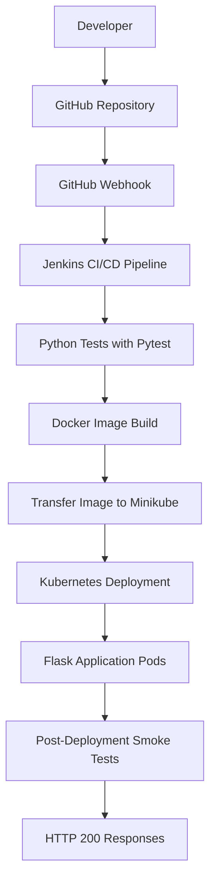

# End-to-End Automated DevOps CI/CD Pipeline

## Project Overview

This project demonstrates an automated CI/CD workflow using GitHub, Jenkins, Docker, Python, and Kubernetes. A GitHub push triggers Jenkins to run tests, build a Docker image, deploy to Minikube, and perform smoke tests.
## Architecture

## Technologies Used

- Linux (Ubuntu)
- Git and GitHub
- Jenkins
- Python and Flask
- Pytest
- Docker
- Kubernetes
- Minikube
## Application Endpoints

- `/` - Displays application information.
- `/health` - Checks application health.
- `/ready` - Checks application readiness.

## CI/CD Pipeline

1. Developer pushes code to GitHub.
2. GitHub webhook triggers Jenkins.
3. Jenkins checks out the source code.
4. Jenkins runs Python tests.
5. Jenkins builds a Docker image.
6. Docker image is transferred to Minikube.
7. Jenkins deploys the application to Kubernetes.
8. Jenkins runs post-deployment smoke tests.

## Project Validation

- All three Python tests passed.
- Docker image built successfully.
- Kubernetes deployment completed successfully.
- All three application endpoints returned HTTP 200.

## Deployment Environment

This project currently uses local Minikube Kubernetes running on Ubuntu WSL2.

AWS EKS deployment, Terraform infrastructure provisioning, and Prometheus/Grafana monitoring are not yet implemented.

## Author

Gangadharbv143

GitHub: https://github.com/Gangadharbv143
