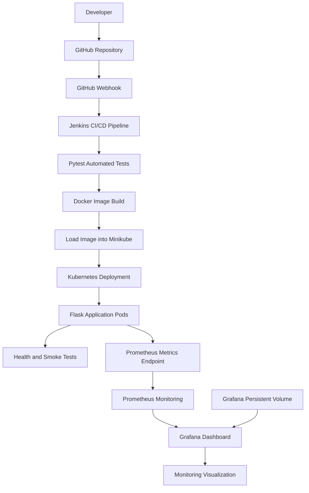
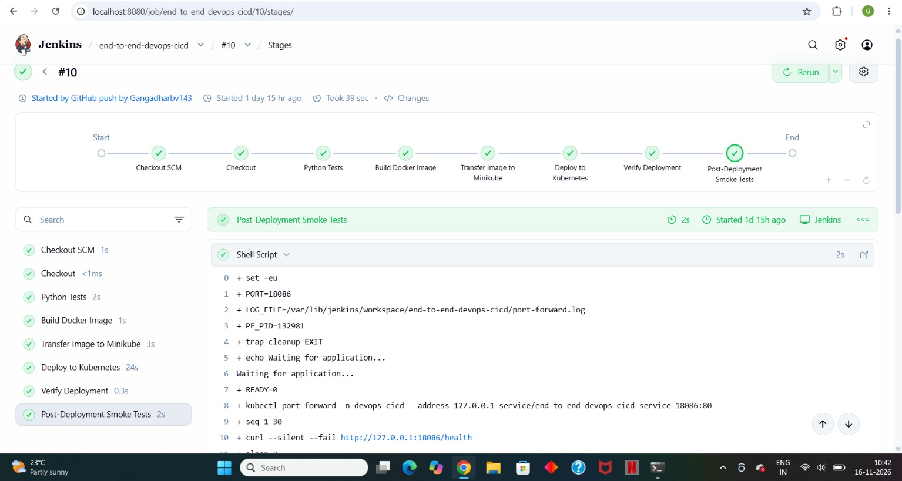
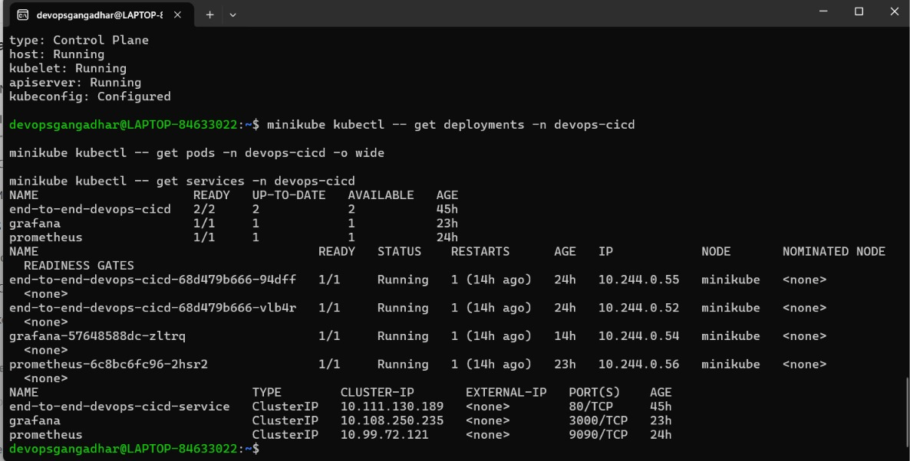
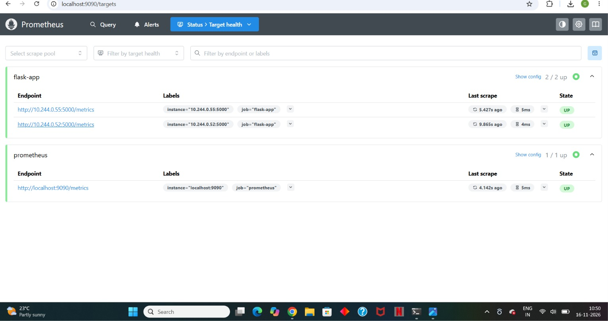
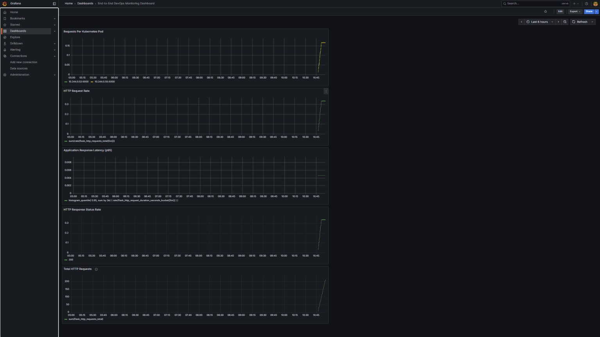
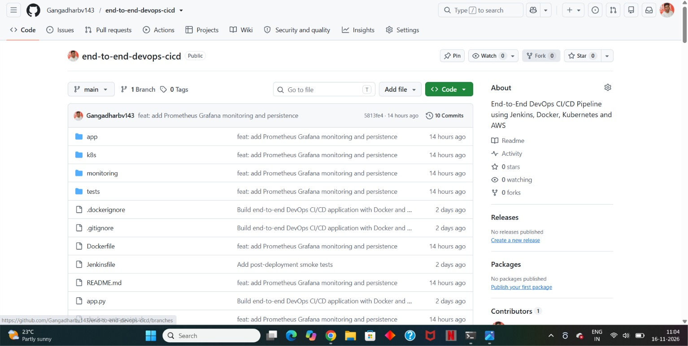

# End-to-End DevOps CI/CD Pipeline with Kubernetes Monitoring

## Project Overview

This project demonstrates an end-to-end automated DevOps CI/CD pipeline for a Python Flask application.

A code push to GitHub triggers Jenkins through a webhook. Jenkins runs automated tests, builds a Docker image, deploys the application to a local Kubernetes cluster using Minikube, and performs post-deployment smoke tests.

The application is monitored using Prometheus and Grafana, with persistent storage configured for Grafana.

## Architecture



## Project Screenshots

### 1. Jenkins CI/CD Pipeline

Successful Jenkins pipeline showing automated checkout, testing, Docker image build, Kubernetes deployment, and post-deployment validation.



### 2. Kubernetes Deployment

Kubernetes deployment showing application pods running successfully in the Minikube cluster.



### 3. Prometheus Monitoring

Prometheus targets page showing successful metric collection from the application pods and Prometheus itself.



### 4. Grafana Monitoring Dashboard

Grafana dashboard displaying application request rates, response latency, HTTP status rates, and Kubernetes pod metrics.



### 5. GitHub Repository

GitHub repository containing the complete project source code and configuration files.



## Technologies Used

| Category | Technologies |
|---|---|
| Operating System | Ubuntu 22.04, WSL2 |
| Version Control | Git, GitHub |
| CI/CD | Jenkins |
| Programming | Python, Flask |
| Testing | Pytest |
| Containerization | Docker |
| Orchestration | Kubernetes, Minikube |
| Monitoring | Prometheus |
| Visualization | Grafana |
| Storage | Kubernetes PersistentVolumeClaim |
| Scripting | Bash, YAML |

## CI/CD Pipeline

1. Developer pushes application code to GitHub.
2. GitHub webhook triggers Jenkins.
3. Jenkins checks out the latest source code.
4. Jenkins executes automated Python tests using Pytest.
5. Jenkins builds the Docker image.
6. The image is transferred into the Minikube environment.
7. Jenkins deploys the application to Kubernetes.
8. Kubernetes manages application pods and service access.
9. Jenkins performs post-deployment smoke tests.

## Application Endpoints

| Endpoint | Purpose |
|---|---|
| `/` | Application information |
| `/health` | Application health check |
| `/ready` | Application readiness check |
| `/metrics` | Prometheus application metrics |

## Monitoring Implementation

Prometheus collects application metrics from the Flask application running inside Kubernetes.

The application exposes metrics through the `/metrics` endpoint using Prometheus instrumentation.

Prometheus uses Kubernetes pod discovery and RBAC permissions to identify application pods and scrape their metrics.

Grafana connects to Prometheus as its data source and visualizes application performance.

### Grafana Dashboard

Dashboard: **End-to-End DevOps Monitoring Dashboard**

The dashboard includes five panels:

1. Requests Per Kubernetes Pod
2. HTTP Request Rate
3. Application Response Latency (p95)
4. HTTP Response Status Rate
5. Total HTTP Requests

### Persistent Monitoring Storage

Grafana uses a Kubernetes PersistentVolumeClaim named `grafana-storage` with a 2Gi storage request.

The Grafana database, dashboard configuration, and data source configuration are stored on the persistent volume.

Persistence was verified by restarting the Grafana Deployment and confirming that the Prometheus data source and all five dashboard panels remained available.

### Monitoring Configuration Files

```text
monitoring/
├── grafana-deployment.yaml
├── grafana-pvc.yaml
├── grafana/
│   └── grafana-dashboard.json
├── prometheus-config.yaml
├── prometheus-deployment.yaml
└── prometheus-rbac.yaml
```

## Project Validation

- Automated Python tests executed using Pytest.
- Docker image built and deployed to Minikube.
- Kubernetes application deployment and service configured.
- Application health, readiness, and metrics endpoints verified.
- Prometheus targets and application metrics verified.
- Grafana Prometheus data source configured successfully.
- Five-panel Grafana monitoring dashboard restored and verified.
- Grafana persistent storage tested successfully after Deployment restart.
- Kubernetes monitoring manifests passed client-side dry-run validation.

## Deployment Environment

The project currently runs locally using:

- Ubuntu 22.04 on Windows WSL2.
- Docker.
- Minikube Kubernetes cluster.

**Note:** This is a local Kubernetes DevOps project. AWS EKS and Terraform-based infrastructure provisioning are not part of the current implementation.

## Repository Structure

```text
end-to-end-devops-cicd/
├── app/
│   ├── __init__.py
│   └── metrics.py
├── k8s/
│   └── deployment.yaml
├── monitoring/
│   ├── grafana-deployment.yaml
│   ├── grafana-pvc.yaml
│   ├── grafana/
│   │   └── grafana-dashboard.json
│   ├── prometheus-config.yaml
│   ├── prometheus-deployment.yaml
│   └── prometheus-rbac.yaml
├── tests/
│   └── test_app.py
├── screenshots/
│   ├── 01-jenkins-successful-pipeline.png
│   ├── 02-kubernetes-deployment.png
│   ├── 03-prometheus-targets.png
│   ├── 04-grafana-dashboard.png
│   └── 05-github-repository.png
├── Dockerfile
├── docker-entrypoint.sh
├── gunicorn.conf.py
├── requirements.txt
└── README.md
```

## Author

**Gangadharbv143**

GitHub: https://github.com/Gangadharbv143
